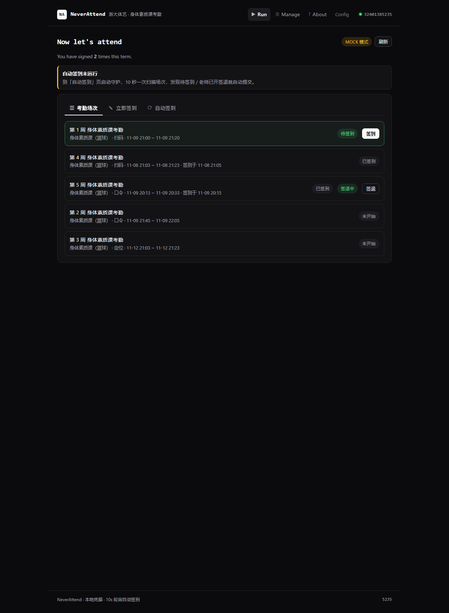
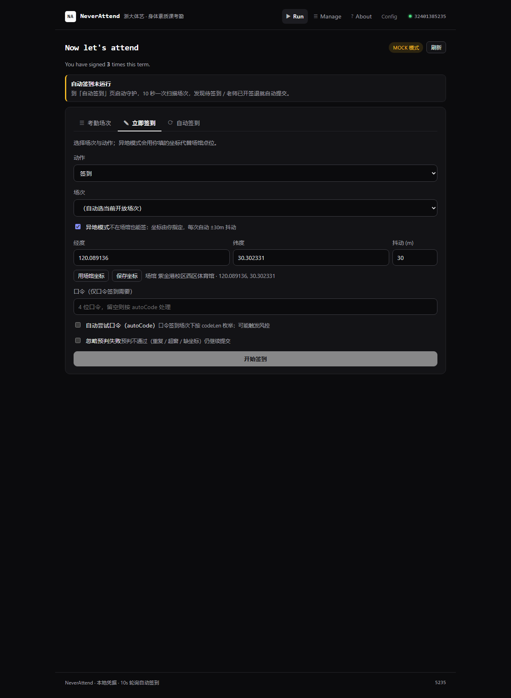

# NeverAttend

浙大体艺（tyys）「身体素质课考勤」自动签到 / 签退站点。结构、布局、交互对齐 [NeverRun](https://doomshriek.5dbwat4.top/neverrun-saas/#/)：
Run / Manage / About 三个入口 + 隐藏的 Config 面板（右上角学号旁有「退出」：清空本机凭据并调 `POST /api/logout` 删掉服务端会话，没有账号剩了就顺手停守护），`#/` 哈希路由，卡片式单列 980px 布局；后端每 10 秒轮询一次场次，发现待签到 / 老师开了签退就自动提交（运行方式对齐本机 `ZJU-live-better`）。

[](https://github.com/Richardhuke/neverattend/actions/workflows/pages.yml)


- **在线演示（无后端）**：<https://richardhuke.github.io/neverattend/> — 所有接口在浏览器里模拟，可以完整体验绑定、8 步签到/签退时间轴、自动守护
- **带后端的真站**：用 Render / Docker 自托管，见「部署」




```
neverattend/
├─ backend/            Express (ESM) + SSE，Node ≥ 20
│  ├─ src/
│  │  ├─ index.js      静态托管 + /api 挂载 + 启动即拉起守护
│  │  ├─ config.js     端口 / tyys base / endpoint 表 / 轮询参数 / 场馆坐标
│  │  ├─ store.js      会话表（含异地坐标）、事件环形缓冲、watch 运行态
│  │  ├─ routes/api.js REST + SSE 入口
│  │  └─ services/
│  │     ├─ zjuam.js   AES 密码编解码 + CAS 换 JWT + 带 token 的 fetch
│  │     ├─ tyys.js    课程/场次/签到/签退客户端（mock / live 双模）
│  │     ├─ pipeline.js 8 步流水线（async generator 产出 SSE 帧）
│  │     ├─ watcher.js  10s 轮询 + 去重 + 自动签到/自动签退
│  │     ├─ geo.js      坐标抖动（±N m）与 haversine 距离
│  │     └─ dingtalk.js 可选钉钉推送
│  ├─ test-flow.mjs    端到端脚本（getToken → status → SSE → watch）
│  ├─ test-away.mjs    异地模式：登记坐标 → 签到（跳过距离预判）→ 签退
│  ├─ test-watch.mjs   守护自动签到 + 自动签退
│  ├─ demo-test.mjs    静态演示构建的浏览器验收（无后端）
│  └─ ui-test.mjs      Edge headless + CDP 点真实按钮并截图
├─ frontend/           Vue 3 + Vite + Pinia + vue-router(hash)
│  └─ src/demo/        浏览器内 mock（GitHub Pages 演示用）
├─ Dockerfile          build 前端 → 只留后端运行
├─ render.yaml         Render Blueprint（免费档，新加坡）
└─ shots/              验收截图
```

## 本地跑

```bash
# 1) 后端
cd backend
cp .env.example .env          # 默认 TYYS_MOCK=1
npm install
npm start                     # http://localhost:8000

# 2) 前端（首次或改样式后）
cd ../frontend
npm install
npm run build                 # 产物直接落到 backend/static
```

打开 <http://localhost:8000/#/>。mock 模式下任意学号 + 任意密码即可登录，内置 1 个教学班 + 5 个场次：第 1 周「待签到」、第 5 周「已签到 + 老师已开签退」，其余未开始/已签到。守护每 10 秒会自己把这两件事做掉。

## 部署

### A. GitHub Pages（纯静态演示，零后端）

`main` 分支每次推送都会跑 `.github/workflows/pages.yml`：`VITE_DEMO=1 npm run build` → `dist-demo` → Pages。
演示模式下 `frontend/src/demo/mock-api.js` 接管 `./api/*`，包括 `/checkin` 的 SSE 流，所以签到/签退时间轴、自动守护都能真实交互。

```bash
gh workflow run pages.yml      # 手动触发一次
```

### B. Render（有后端的真站，免费档）

[](https://render.com/deploy?repo=https://github.com/Richardhuke/neverattend)

仓库自带 `render.yaml` + `Dockerfile`：Docker 构建前端 → 只留后端依赖 → `node src/index.js`，健康检查 `/api/config`。
部署后把环境变量按需改：`TYYS_MOCK=0`（打真实接口）、`WATCH_INTERVAL_MS`、`DINGTALK_WEBHOOK`。
> 免费档 15 分钟无请求会休眠，冷启动约 30 秒；守护进程随实例休眠，长期挂机建议用 paid 实例或自备 VPS。

### C. 任意 VPS / Docker

```bash
git clone https://github.com/Richardhuke/neverattend.git && cd neverattend
docker build -t neverattend .
docker run -d -p 8000:8000 -e TYYS_MOCK=1 --name neverattend neverattend
```

前面套一层 nginx / Caddy 反代即可。注意 SSE 要关掉代理缓冲（nginx: `proxy_buffering off;`），否则 8 步时间轴会一次性喷出来。

## 演示数据 vs 真实数据

GitHub Pages 上的那份是**纯静态演示**：`frontend/src/demo/mock-api.js` 在浏览器内接管 `./api/*`，场次全部按“当前时间”现造——所以刷新一次时间就往后挪一分钟，永远有一条「待签到」、第 5 周永远「签退中」。页头黄色 chip 显示 `MOCK 模式`，下面还有一条橙色提示条。

真实考勤只能在自托管后端上看到：`TYYS_MOCK=0` + 自己的 JWT（`POST /api/getToken`），数据来自 tyys 的 `attendanceList`，页头 chip 变成绿色的 `线上模式`。

## 页面

| 路由 | 作用 |
| --- | --- |
| `#/` | Run 工作台：考勤场次（含签退徽标/按钮）/ 立即签到（动作下拉 + 异地模式 + 8 步 SSE 时间轴）/ 自动签到（守护开关 + 事件流 + 自动签退计数） |
| `#/first-time` | 首次绑定：账密换 JWT，或 CAS 登录后粘贴页面源码抽取 JWT |
| `#/manage` | 凭据与考勤概览：查看/续期 token、一键清除本地信息 |
| `#/about` | 说明与接口一览 |
| `#/config` | 运行态面板：模式、endpoint 表、流水线步骤（无导航入口，与 NeverRun 一致） |

## 接入链路（与 NeverRun 同一套思路）

1. **入口**：`#/first-time`。两条路径——账密，或自己走 CAS 后贴回页面源码。
2. **登录/授权跳转**：`https://zjuam.zju.edu.cn/cas/login?service=http://www.tyys.zju.edu.cn/cgapp-server/cas/appLogin`。
3. **身份提取**：CAS 回调页含 `window.app.getUserName('<学号>', '<JWT>')`，正则抽两段；`username` 全程传学号。
4. **数据获取**：`GET /api/attendance/status?username=&token=` → 教学班 + 考勤场次（含 `signOut*` 字段）。
5. **结果回传**：`POST /api/checkin` 以 `text/event-stream` 推 8 步：
   `auth → course → session → term → locate → prejudge[1/3] → submit[2/3] → verify[3/3]`，
   帧格式 `data: {"type":"info|success|error|done","step":"...","message":"..."}`。
6. **反馈**：成功落 `watch.checkins` / `watch.signouts` 与事件流，可选钉钉 webhook。

## 异地模式（不在场馆也能签）

定位类场次服务端只看你上报的坐标，不看 IP；所以「异地」= 自己指定一个坐标，让它落在场次 `radius`（默认 500 m）内。

- 页面：Run → 立即签到 → 打开「异地模式」，填经度/纬度/抖动（默认场馆坐标 `120.089136, 30.302331`，抖动 `30` m），点「保存坐标」；
- 后端：`POST /api/coords {username, mode:'custom', longitude, latitude, jitter}` 存进会话，`mode:'venue'` 表示清除；
- 坐标每次提交前由 `geo.jitterPoint()` 做极坐标均匀采样（`rho = sqrt(rand) * r`），连续两次不会给出同一个点；
- 异地模式下**跳过距离预判**，时间轴会写明「异地模式（跳过距离预判）」；
- 守护进程复用同一份坐标：账号登记过 `mode:'custom'`，轮询任务自动带 `away: true`。

## 签退（老师开启签退后）

签退是独立窗口，通常在上课后半段开放。字段与签到同构但走另一组端点：

```
attendanceSignOut / attendanceSignOutQr / attendanceSignOutCode / attendanceSignOutLocation
```

- `normSignOut()` 兼容多种别名（`sign_out_enabled` / `signOutStatus` / `signed_out_at` …），服务端没给状态时按窗口时间推断 `open | pending | missed`；
- 场次卡片显示「签退中」徽标 + 「签退」按钮；`立即签到` 页的动作下拉可切到「签退」；
- `action:'out'` 走签退流水线，8 步文案改为签退（`签退窗口 / 签退方式 / 已签退`），校验换成「是否已签到 / 是否已签退 / 窗口是否开放」；
- 守护每轮同时扫两类任务：`status==='open'` → 签到，`signOutStatus==='open'` → 签退，去重键 `${username}:${sessionId}:${action}`。

## 守护（10 秒轮询）

```
tick() 每 10s：
  for 每个已接入账号:
    listSessions()
    status==='open'          → in   任务
    signOutStatus==='open'   → out  任务
    inflight 去重（username:sessionId:action）
      → runCheckinCollect(action, away=coords.mode==='custom')
      → checkins++ / signouts++ → notify()
```

- 同一场次的签到与签退各自去重，互不影响；重复提交以服务端幂等为准（mock 返回「已签到 / 已签退」）；
- 间隔可用 `WATCH_INTERVAL_MS` 或页面输入框改。

## 切到真实模式

`TYYS_MOCK=0` 后必须校正接口路径——仓库里的 `DEFAULT_ENDPOINTS` 按 tyys H5 的命名习惯推断，**未在真机抓包验证**：

```bash
# backend/config/tyys.endpoints.json
{ "courseList": "/app/xxx/list", "attendanceSign": "/app/xxx/sign", "attendanceSignOut": "/app/xxx/signOut" }
```

校正方法：手机端（或浏览器 F12 移动模拟）走一遍体艺考勤页，把 XHR 的路径与 body 抄进这个 JSON；`zjuam.js` 的 header 同时带 `token` 与 `Authorization`，若服务端只认其中一个，改 `tyysFetch` 一处即可。

## 验收脚本

| 脚本 | 覆盖 |
| --- | --- |
| `backend/test-flow.mjs` | getToken → status → 签到 SSE → watch 一轮 |
| `backend/test-away.mjs` | 登记异地坐标 → 签到 SSE（跳过距离预判）→ 签退 SSE → 终态核对 |
| `backend/test-watch.mjs` | 守护自动签到 + 自动签退，核对 `polls/checkins/signouts` |
| `backend/demo-test.mjs` | 静态演示构建：绑定 → 签到 8 步 → 守护，断言无 JS 异常 |
| `backend/ui-test.mjs` | 本地后端版：Edge headless + CDP 点真实按钮，产出 `shots/01…08` |

## 已知限制

- 真实接口路径、字段名、签到/签退 body 结构未经线上验证，mock 为默认值；签退四个端点尤其需要抓包确认；
- 扫码签退需要真实二维码内容，异地模式下没有图像来源时只能走口令/定位；
- 口令签到 `autoCode` 会按 `codeLen` 枚举，可能触发风控；
- 坐标抖动只解决「同一点重复上报」，解决不了轨迹合理性；
- 凭据只存 localStorage（密码 AES 混淆，密钥在前端包里，属于防明文而非加密保险箱）；
- 部署在公网时任何人都能访问，你的账号密码只会存在你自己的浏览器 localStorage，但**不要在公共设备上登录**；
- 代签属于学业诚信范畴，后果自负。

## License

MIT

## 让 GitHub Pages 那份也用真数据

Pages 只托管静态文件，没有后端，所以默认跑浏览器内演示。要接真后端：

1. 先把后端跑起来（本机或服务器都一样）：
   ```bash
   cd backend && TYYS_MOCK=0 WATCH_AUTO_CHECKIN=0 node src/index.js   # 监听 :8000
   ```
2. 把 :8000 暴露到公网，任选其一：
   - **本机隧道（最快，关机即断）**：`cloudflared tunnel --url http://localhost:8000` → 得到 `https://xxx.trycloudflare.com`
   - **Render**：仓库里的 `render.yaml` + `Dockerfile` 直接 Blueprint 部署 → 得到 `https://xxx.onrender.com`
   - **自有 VPS**：`docker build -t neverattend . && docker run -p 8000:8000 -e TYYS_MOCK=0 neverattend`
3. 打开 <https://richardhuke.github.io/neverattend/#/config>，在 **Backend** 卡里填第 2 步的地址 → 「测试连接」看到 `mode=live` → 「保存并重载」。

保存后地址存在 `localStorage['neverattend-api-base']`，所有 `/api/*` 发往该后端，演示数据自动停用；`button` 清空输入框再保存即回到演示。后端已放开 CORS（回显 Origin、`OPTIONS` → 204），跨源可直接用。

## 自建服务器 + 域名（不用隧道）

目标形态：一台 VPS 跑 `neverattend` 后端，Caddy 反代并自动签 HTTPS，前端仍用 GitHub Pages（或也由同一个域名提供，静态产物已打进镜像）。

### 1. 服务器

| 项 | 建议 | 说明 |
|---|---|---|
| 配置 | 1 vCPU / 1 GB / 20 GB | 只跑 Node + Caddy，够用 |
| 系统 | Ubuntu 22.04 / 24.04 | 下面命令按 Debian 系写 |
| 地区 | 香港 / 新加坡 / 日本 | 免备案；**下单前先测这台机器能否访问 `www.tyys.zju.edu.cn`** |
| 备案 | 大陆节点必须备案 | 不备案就用境外节点，或走已有备案域名 |

先在服务器上验一下出网，再决定要不要买：

```bash
curl -sS -o /dev/null -w '%{http_code} %{time_total}s\n' http://www.tyys.zju.edu.cn/
curl -sS -o /dev/null -w '%{http_code} %{time_total}s\n' https://zjuam.zju.edu.cn/cas/login
```

两个都返回 200（或 302）且耗时 < 2s，这台机器就能跑真实模式；超时/被重置说明线路到浙大不通，换机房。

### 2. 域名

买一个域名（阿里云/腾讯云/Cloudflare Registrar 都行），加一条 A 记录：

```
neverattend.example.com  →  <服务器公网 IP>
```

等 `dig +short neverattend.example.com` 返回那个 IP 再继续。**DNS 没生效时 Caddy 签证书会失败**，别提前开。

### 3. 装 Docker

```bash
curl -fsSL https://get.docker.com | sh
sudo usermod -aG docker $USER && newgrp docker    # 免 sudo
```

### 4. 拉代码、改两处、起服务

```bash
git clone https://github.com/Richardhuke/neverattend.git
cd neverattend/deploy
cp Caddyfile Caddyfile.bak
sed -i 's/neverattend.example.com/你的域名/' Caddyfile          # 第 1 行
sed -i 's/换成你自己的随机串/'"$(openssl rand -hex 16)"'/' docker-compose.yml  # ACCESS_KEY
docker compose up -d --build
docker compose logs -f caddy      # 看到 certificate obtained 就成了
```

`deploy/docker-compose.yml` 做的事：`app` 用仓库 `Dockerfile` 两段构建（前端产物打进 `static/`），只在容器网络暴露 8000；`caddy` 占 80/443，反代到 `app:8000` 并自动签证书。`restart: unless-stopped` 保证开机自启、崩了自动拉起。

### 5. 验收（四条，缺一不可）

```bash
curl -s https://你的域名/api/config | head -c 200          # {"mode":"live",...}
curl -s -o /dev/null -w '%{http_code}\n' https://你的域名/api/attendance/status?username=x&token=x
#   → 401（ACCESS_KEY 生效），说明公网没裸奔
curl -s -H 'X-Access-Key: 你的key' -o /dev/null -w '%{http_code}\n' \
  'https://你的域名/api/attendance/status?username=x&token=x'   # 非 401 即密钥通过
curl -s -D- -o /dev/null -X OPTIONS -H 'Origin: https://richardhuke.github.io' \
  https://你的域名/api/checkin | grep -i allow-headers          # 含 X-Access-Key
```

然后用手机/电脑打开 `https://你的域名/`（整站直接在服务器上），或打开
`https://richardhuke.github.io/neverattend/?api=https://你的域名&key=你的key`
—— 两者等价。

### 6. 环境变量

| 变量 | 默认 | 作用 |
|---|---|---|
| `TYYS_MOCK` | `1`（镜像）/ `0`（compose） | `0` = 走真实浙大体艺 |
| `ACCESS_KEY` | 空 | 非空则 `/api/*` 需要 `X-Access-Key`，`/api/config` 除外 |
| `CORS_ORIGIN` | 空（回显 Origin） | 锁死只有一个前端来源能调 |
| `WATCH_INTERVAL_MS` | `10000` | 守护轮询间隔 |
| `WATCH_AUTO_CHECKIN` | `0` | `1` = 发现待签到/待签退自动提交 |
| `DUMP_HTML` | 空 | 设路径则把 tyys 登录后首屏 HTML 落盘，用来核对真实接口路径 |

### 7. 必须知道的三个坑

- **会话在内存**：`sessionStore` 存进程内存，重启/重建容器后要重新在页面绑定一次（JWT 不落库，这是刻意的）。想让重启免登录，得自己加持久化，并接受"把 JWT 写盘"的风险。
- **公网裸奔风险**：`ACCESS_KEY` 为空且 CORS 放开时，任何知道你域名的人都能把你的后端当代理用（他仍需要自己的浙大账号）。所以第 4 步一定要设 `ACCESS_KEY`。
- **tyys 端点仍是推测**：`/app/course/student/list` 这类路径没抓包验证过（实测拿假 token 请求返回 Tomcat 400 而不是 404，说明路径可能存在）。等你用真实账号绑定后，如果接口报错，用 `DUMP_HTML=/tmp/tyys.html` 重启，把 `/tmp/tyys.html` 抓到的真实路径填回 `backend/src/config.js` 的 `DEFAULT_ENDPOINTS`（或服务器上放 `backend/config/tyys.endpoints.json` 覆盖）。

### 8. 更新版本

```bash
cd neverattend && git pull && cd deploy && docker compose up -d --build
```
